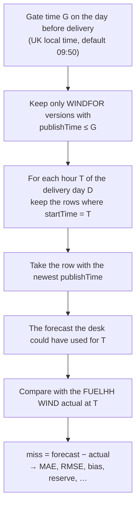
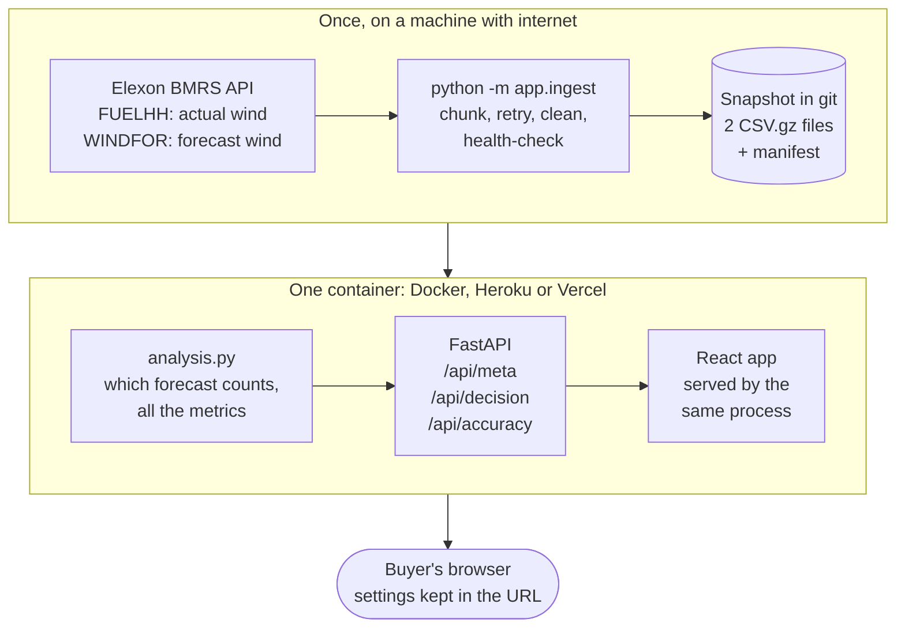

# Day-ahead wind desk

A web portal for a UK energy utility's day-ahead buying desk. For every purchase decision made in **January 2026** it answers two questions, using Elexon wind data only:

1. **Which wind forecast could the desk actually use when the decision had to be made?** The newest forecast published at or before the day-ahead gate, hour by hour, with the forecasts that arrived too late shown alongside.
2. **How wrong are those forecasts, in numbers?** Typical miss, big misses, bias, reserve to hold, and how all of these change with how early the forecast was issued, the day and the hour.

> **Live app:** https://kvcazn.vercel.app  
> **Demo video:** `https://REPLACE-WITH-YOUR-UNLISTED-YOUTUBE-URL`

---

## Start it

You need either Docker, or Python 3.12+ and Node 22+.

### With Docker (what gets deployed)

```bash
docker compose up --build        # then open http://localhost:8000
```

The image serves the API and the built React app together and **refuses to start without the Elexon snapshot** in `backend/data/snapshot/` (so it can never show made-up numbers by accident). If the snapshot is missing, create it first:

```bash
make data            # Python 3.12+ installed locally
make data-docker     # or: no Python needed, runs inside Docker
```

Without `make`: `cd backend && python -m venv .venv && .venv/bin/pip install -r requirements.txt && .venv/bin/python -m app.ingest`
(on Windows use `.venv\Scripts\python`).

### For development (two terminals)

```bash
make install                     # backend venv + frontend packages
make api                         # terminal 1: API on http://127.0.0.1:8000
make ui                          # terminal 2: UI on http://localhost:5173 (proxies /api to the API)
make test                        # backend (pytest) and frontend (vitest)
```

No snapshot yet? `REQUIRE_REAL_DATA=0 make api` serves **synthetic demo data**; the page then shows a yellow "Demo data" banner. Never submit that.

**Windows (PowerShell), no `make`:** run the equivalents directly.

```powershell
# install
cd backend; py -3.12 -m venv .venv; .\.venv\Scripts\pip install -r requirements-dev.txt; cd ..
cd frontend; npm ci; cd ..
# tests
cd backend; .\.venv\Scripts\python -m pytest -q; cd ..
cd frontend; npm test; cd ..
# refresh the data snapshot
cd backend; .\.venv\Scripts\python -m app.ingest; cd ..
# run the API against the committed snapshot
cd backend; $env:REQUIRE_REAL_DATA="1"; .\.venv\Scripts\uvicorn app.main:app --port 8000
```

### Refresh the data without installing anything

On GitHub: **Actions → refresh-data → Run workflow**. It downloads January 2026 from Elexon on GitHub's servers and commits `backend/data/snapshot/`.

---

## What the portal shows

| Tab | What it answers |
|---|---|
| **Decision** | Pick a decision day and the gate time. See the wind to count on for tomorrow (average, peak, low, energy), the exact forecast version used and how old it was, a draggable timeline of every forecast version issued that day, the hourly forecast against what actually happened with a range for where 8 in 10 past hours landed, and how the forecast for the day changed around the gate. |
| **Forecast accuracy** | Six headline numbers, then the miss by how early the forecast was issued, the spread of misses (how big and which way), by delivery day and by hour of day. Every chart has a table view of the same numbers. |
| **Method** | The decision rule, every measure with a plain-words description, a formula and a worked example, and the data and assumptions. |

Settings (decision day, gate time, how actuals are matched) live in the URL, so any view can be bookmarked or shared.

## How the "forecast available at decision time" is chosen



If the newest version has no row for hour T, the next newest that does is used. Anything published after G is shown in the revisions chart as dashed, "could not have had it".

**Why this matters.** Elexon issues a new wind forecast about eight times a day. A model that judged "the forecast" using the newest version for each hour would flatter the forecasts, because that version is often issued after the buying decision was already made.

### Assumptions (all in `backend/app/config.py`)

| Assumption | Choice | Why / how to change |
|---|---|---|
| Gate time | **09:50 UK**, the N2EX day-ahead auction close. EPEX GB hourly auction closes 09:20. | The brief says "one day before delivery" without a time. Both presets are one click in the UI; any time can be typed or dragged. |
| "January 2026" | Decisions made **1–31 Jan**, for delivery the next day (**2 Jan – 1 Feb**). | `DECISION_START`, `DECISION_END`, `DAYS_BEFORE`. |
| When a forecast counts as available | From its `publishTime`, which the brief defines as "the time at which the forecast was created". | Any delay before it reaches the desk is not modelled; set the gate earlier to allow for one. |
| Hourly forecast vs half-hourly actual | Default **same timestamp**: forecast for 10:00 vs the actual for the half-hour starting 10:00. Alternative **hourly average**: mean of the 10:00 and 10:30 actuals. | Nothing is invented in the default; switch in the UI. |
| Sign of the miss | `forecast − actual`. Positive = wind fell short of the forecast = the desk bought too little. | Matches the risk the desk cares about. |
| Range on the forecast chart | 10th–90th percentile of past misses at the same gate, **leaving the selected day out**. | Out-of-sample, so the day is not graded against its own errors. Needs ≥ 30 other hours. |
| Reserve | 90th percentile of the miss, never below zero. | The extra power that would have covered 9 in 10 past hours. |
| Scope | National, transmission-connected wind only. No demand, solar, prices. | As specified in the brief. |
| Time | All clock times are UK local time; days are 23/24/25 hours across clock changes. | Elexon timestamps are UTC. |

## Data

| | Elexon BMRS Insights API (`https://data.elexon.co.uk/bmrs/api/v1`, open, no key) |
|---|---|
| Actuals | `datasets/FUELHH/stream`, `fuelType=WIND`. Half-hourly `startTime` and `generation` (MW). |
| Forecasts | `datasets/WINDFOR/stream`. Hourly `startTime` and `generation`, each stamped with `publishTime`: about eight versions a day, each covering roughly 73 hourly points. |
| Window | Actuals for settlement days 1 Jan – 1 Feb 2026; forecasts published 31 Dec 2025 – 2 Feb 2026. |

`python -m app.ingest --check` makes one small request per dataset and prints what came back. `python -m app.ingest` downloads the whole window (in chunks, with retries), cleans it (WIND only, duplicates removed, numbers coerced), runs health checks (missing half-hours, versions per day, points per version) and writes `backend/data/snapshot/`. The app serves that snapshot, so a deployment always shows the same numbers and does not depend on Elexon being up.

**Licence.** Contains BMRS data © Elexon Limited copyright and database right 2026. The data is used under the [BMRS open data licence](https://www.elexon.co.uk/data/balancing-mechanism-reporting-agent/copyright-licence-bmrs-data/), which asks for exactly this statement; the portal's footer repeats it. The committed snapshot is a copy of that data, so the statement covers it too. Elexon has no role in this project and does not endorse it.

## API

JSON in camelCase. Interactive docs at `/docs`.

| Endpoint | Returns |
|---|---|
| `GET /api/health` | `{status, dataSource}` |
| `GET /api/meta` | Data source and fetch time, decision window, default gate, gate presets, matching options, the list of decision days, row counts |
| `GET /api/decision?decisionDate=2026-01-14&cutoff=09:50&alignment=exact` | The forecast used for each delivery hour (with the version, its age, the actual, the miss and the range), half-hourly actuals, day summary, every version issued that day, nearby versions for the revisions chart |
| `GET /api/accuracy?cutoff=09:50&alignment=exact` | Overall metrics, error quantiles, reserve, and breakdowns by day, hour of day, forecast horizon, plus a histogram of misses |

`alignment` is `exact` or `hourly_mean`. A decision date outside January 2026 or a malformed `cutoff` gets a `422`; a day with no forecast gets a `404`.

## Files and directories

```
.
├── README.md
├── AGENTS.md                  guidance for AI coding tools: commands, invariants, conventions
├── Dockerfile                 multi-stage: builds the React app, then a slim Python image serves API + app
├── docker-compose.yml         `web` (the app) and `ingest` (refreshes the data)
├── heroku.yml                 Heroku container deploy
├── vercel.json                Vercel deploy config (buildCommand, functions, rewrites)
├── api/index.py               Vercel serverless function; re-exports backend.app.main:app
├── requirements.txt           copy of backend/requirements.txt that Vercel reads from the root (CI checks they match)
├── Makefile                   install / api / ui / test / data / docker
├── .github/workflows/
│   ├── ci.yml                 tests, build, Docker build and smoke test
│   └── refresh-data.yml       one-click Elexon download, commits the snapshot
├── docs/DECISIONS.md          the design decisions and what was rejected
├── qa/                        scripted browser checks (Playwright), see qa/README.md
├── backend/
│   ├── app/
│   │   ├── config.py          every assumption in one place
│   │   ├── elexon.py          Elexon client: chunked requests, retries, cleaning
│   │   ├── ingest.py          CLI that builds the snapshot, with health checks
│   │   ├── store.py           reads/writes the snapshot; demo-data fallback
│   │   ├── analysis.py        forecast-at-decision-time selection and all the metrics
│   │   ├── schemas.py         API response models
│   │   ├── main.py            FastAPI routes; serves the built UI at /
│   │   └── demo_data.py       synthetic data for development and tests only
│   ├── data/snapshot/         the Elexon data the app serves (committed)
│   └── tests/                 pytest: selection rule, metrics, API, ingest
└── frontend/
    ├── src/
    │   ├── App.tsx            tabs, settings, URL state
    │   ├── api.ts, types.ts   typed calls to the API
    │   ├── format.ts          numbers and UK-time formatting
    │   ├── scale.ts           round axis maxima
    │   ├── hooks.ts           data loading, debounce, width
    │   ├── styles.css         design tokens (light and dark) and layout
    │   └── components/        DecisionView, AccuracyView, MethodView, GateStrip,
    │                          LineChart, ColumnChart, ChartFrame, FilterBar, …
    └── package.json
```

## Design in brief



- **One analysis module.** `analysis.py` is pure pandas with no web code, so the rule that matters (which forecast counts) is small, readable and tested. The tests include an independent brute-force re-computation of the selection on every decision day, hand-checked metric values, and the clock-change cases.
- **Snapshot, not live calls.** January 2026 is history, so the data is fetched once and committed. Deploys are reproducible and the demo cannot fail because an upstream API is down.
- **Charts are hand-built SVG** (d3 scales only for the maths): thin marks, direct labels, a legend whenever there are two series, hover and keyboard tooltips, and a table twin of every chart for screen readers and for checking the numbers. Forecast is always blue and actual always orange, validated for colour-blind readers in light and dark.
- **One container.** FastAPI serves the API and the built app, so there is no CORS, one URL and one thing to deploy.

More in [`docs/DECISIONS.md`](docs/DECISIONS.md).

## Deploy

**Heroku (container).** Needs the Heroku CLI and an account with billing (Eco dynos are about $5/month).

```bash
heroku create <app-name>
heroku stack:set container
git push heroku main
heroku open
```

`heroku.yml` points at the Dockerfile; the container listens on `$PORT`.

**Vercel (free alternative).** Import the GitHub repo in Vercel and leave the build settings at their defaults, or use the CLI: `vercel link --project <name>` then `vercel deploy --prod`. Vercel detects FastAPI from `requirements.txt`, selects Python 3.12 from `.python-version`, and uses `vercel.json`: the `buildCommand` copies the React build into `public/` (Vercel's static output) and the serverless function `api/index.py` re-exports the FastAPI app; `rewrites` route `/api/*`, `/docs` and `/openapi.json` to the function while the SPA shell is served statically from `public/`. Add the environment variable `REQUIRE_REAL_DATA=1` (`vercel env add REQUIRE_REAL_DATA production`) so a missing snapshot fails loudly instead of showing demo data. The function bundle limit is 500 MB uncompressed; pandas and the snapshot fit easily.

After deploying, open the URL in a private window and check `/api/health` says `"dataSource": "elexon"`. After a quiet period the first request can take a few seconds while the host starts the app (Heroku Eco dynos sleep when idle; Vercel starts functions on demand).

## AI use

AI tools were used to build this, as the brief allows:

- **Claude (Anthropic)**, running in a sandbox with no network access to Elexon, no Docker and no accounts, did the domain research, designed the architecture and the decision rule, and wrote the first version of the backend (`backend/app/`), the React app (`frontend/src/`), the backend and frontend tests (60 + 13), the Playwright browser checks (`qa/`), the Docker and CI configuration, `vercel.json`, and this README. Everything it wrote was exercised against synthetic data that imitates the shape of the Elexon feeds.
- **Cursor** then took over on a real Windows machine with internet access and ran the project end to end against the real Elexon API: ran `make install`, `pytest` and `vitest`, downloaded the real January-2026 snapshot via `python -m app.ingest` and committed it, added raw-shape fixtures (`backend/tests/fixtures/`) and a test that pins the live Elexon response shape (`backend/tests/test_raw_shape.py`), wrote a live cross-check (`backend/tests/test_live_crosscheck.py`, marker `live`, guarded by `RUN_LIVE=1`) that independently re-derives every decision point and the monthly MAE/bias from the raw API and asserts the app matches to within 0.5 MW, confirmed each of the sanity anchors in the prompt against the raw API, ran the 56-step Playwright suite against the real data locally and against the live URL, updated `vercel.json` (moved the function to `api/index.py` and added the `/api/*` rewrite — the Vercel Python runtime now requires serverless functions under `api/`), deployed to Vercel and wrote this paragraph.
- All numbers on screen come from Elexon data through code in this repository. The core rule and the metrics are covered by automated tests that check them independently of the implementation (brute-force recomputation on synthetic data; raw-API cross-check on live data).

## Limits

- Wind only. Demand, solar, embedded wind, prices and the actual bids a desk would place are out of scope; the portal says how much wind to count on and how wrong that number tends to be, not what to buy.
- One month of history: error statistics describe January 2026 and are not a guarantee for other seasons.
- The gate time is an assumption to confirm with the desk (see above).
